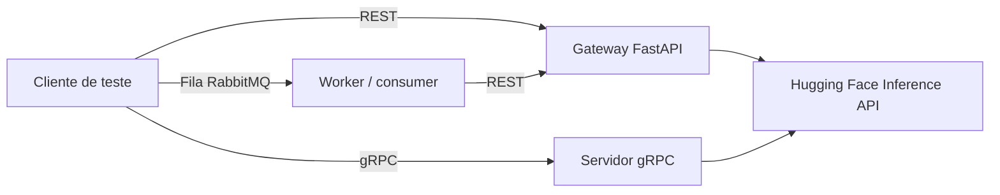

# PIBIC - UNICAP

Repositório dedicado ao PIBIC (Programa de Iniciação Científica) da UNICAP.

## Sobre o projeto

O projeto avalia **padrões de comunicação e arquiteturas de integração** entre clientes e APIs que consomem **LLMs de sumarização de texto**. Para isso, foi construído um **API Gateway** sobre a Inference API do Hugging Face e, a partir dele, são executadas baterias de testes comparando desempenho, estabilidade e custo estimado de cada padrão.

### Padrões comparados

| Padrão | Descrição | Notebook |
| --- | --- | --- |
| REST síncrono | Requisições HTTP bloqueantes ao gateway | [pibic_teste_aplicacao_rest_sync.ipynb](pibic_teste_aplicacao_rest_sync.ipynb) |
| Filas assíncronas | Producers/consumers com RabbitMQ (padrão RPC com `reply_to` e `correlation_id`) | [pibic_queue_rabbitmq.ipynb](pibic_queue_rabbitmq.ipynb) |
| gRPC | Chamadas unárias sobre HTTP/2 com Protocol Buffers | [pibic_grpc_service_test.ipynb](pibic_grpc_service_test.ipynb) |

### Modelos de sumarização utilizados

- `facebook/bart-large-cnn`
- `google/pegasus-cnn_dailymail`
- `knkarthick/MEETING_SUMMARY`
- `google/pegasus-xsum`

## Estrutura do repositório

| Arquivo | Função |
| --- | --- |
| [pibic_aplicacao_llm_gateway.ipynb](pibic_aplicacao_llm_gateway.ipynb) | Gateway REST (FastAPI + Uvicorn) exposto via ngrok |
| [pibic_teste_aplicacao_rest_sync.ipynb](pibic_teste_aplicacao_rest_sync.ipynb) | Testes do padrão REST síncrono, análise, gráficos e estudo de caching |
| [pibic_queue_rabbitmq.ipynb](pibic_queue_rabbitmq.ipynb) | Testes do padrão de filas assíncronas com RabbitMQ |
| [pibic_grpc_service_test.ipynb](pibic_grpc_service_test.ipynb) | Servidor e cliente gRPC, testes, análise e gráficos |

Todos os notebooks foram desenvolvidos para execução no **Google Colab** (cada um possui o badge "Open In Colab").

## Arquitetura

### Gateway REST

Implementado com FastAPI e publicado por túnel ngrok.

- `GET /`: verificação de saúde.
- `POST /summarize?model=<model_key>`: corpo `{"text": "..."}`; resposta `{"summary": "..."}`. O modelo padrão é `facebook_bart_large_cnn`.

Chaves de modelo aceitas (`model_key`):

- `facebook_bart_large_cnn`
- `google_pegasus_cnn_dailymail`
- `knkarthick_MEETING_SUMMARY`
- `google_pegasus_xsum`

### Filas assíncronas (RabbitMQ)

- Fila de requisições: `request_summarize_queue`.
- Cada cliente/producer cria uma fila de resposta exclusiva e temporária, identificando a resposta por `correlation_id`.
- O worker/consumer processa uma mensagem por vez (`prefetch_count=1`), chama o gateway REST e publica a resposta na fila do cliente.
- 30 clientes (threads) por prompt.

### gRPC

- Serviço `LLMGateway` com o método unário `Summarize(SummarizeRequest) -> SummarizeResponse` (`text`, `model_key` -> `summary`, `tokens_in`, `tokens_out`).
- Servidor na porta `50051` com `ThreadPoolExecutor(max_workers=10)`.
- Servidor e cliente rodam em *loopback* (localhost) no mesmo ambiente, isolando a latência do protocolo e da inferência de variáveis externas de rede (como o túnel ngrok), garantindo isonomia na comparação com o REST.

## Metodologia experimental

- **8 prompts** em inglês, com diferentes extensões e temas (energia solar, Ouro Preto, inteligência artificial, música clássica, história da internet, entre outros).
- **30 requisições por prompt** para cada modelo (240 execuções por bateria).
- Execução repetida para os **4 modelos**.
- Contagem de tokens com o `AutoTokenizer` do Hugging Face correspondente a cada modelo.
- Custo estimado: `(tokens_in + tokens_out) / 1000 * US$ 0,0006`.
- Fluxo de cada notebook: **testes** -> CSV bruto -> **análise** -> CSV de métricas -> **consolidação** entre modelos -> **gráficos**.

### Métricas coletadas

| Métrica | Descrição |
| --- | --- |
| Média, mínimo e máximo | Latência por prompt (s) |
| Desvio padrão | Dispersão absoluta dos tempos |
| Coeficiente de variação (CV%) | Dispersão relativa à média |
| Percentis P95 e P99 | Latência de cauda |
| Throughput | Requisições por segundo |
| Tokens de entrada e saída | Contagem real com o tokenizer do modelo |
| Custo médio e total (USD) | Estimativa baseada em tokens |

### Gráficos gerados

Vazão média por modelo, boxplot de latência, percentis P95/P99, coeficiente de variação e eficiência econômica (custo por 1k tokens).

## Caching (estudo no notebook REST)

Camadas de cache para reduzir latência, custo de tokens e carga/rate limit nas APIs de inferência:

- **Exact-Match Cache**: correspondência exata do prompt via hash SHA-256.
- **Layered Cache**: L1 em memória (`cachetools.LRUCache`) e L2 distribuída (`Redis`), consultadas na ordem L1 -> L2.
- **Context-Aware Cache**: a chave combina `model_key` e `prompt_text`, evitando colisões entre modelos.

## Dados gerados

Os notebooks escrevem os seguintes artefatos (criados em tempo de execução, não versionados no repositório):

- `raw/raw_data_requests_<modelo>.csv` e `raw/raw_data_grpc_<modelo>.csv`: dados brutos por requisição.
- `metrics/metrics_data_requests_<modelo>.csv` e `metrics/metrics_data_grpc_<modelo>.csv`: métricas por prompt.
- `models_metrics_data_requests.csv` e `models_metrics_data_grpc_final.csv`: consolidado de todos os modelos.
- `comp_final_models.csv`: comparativo final entre modelos.
- Gráficos em `.png`.

## Como executar

1. Abra o notebook desejado no Google Colab.
2. Configure os *secrets* do Colab:
   - `HUGGINGFACE_TOKEN`: token da Inference API do Hugging Face.
   - `NGROK_AUTH_TOKEN`: token do ngrok (apenas para o gateway REST).
3. **REST e filas**: execute o notebook do gateway, copie a URL pública do ngrok e atribua a `API_URL` nos notebooks de teste.
4. Defina o modelo na variável `MODEL` (REST e filas) ou `CURRENT_MODEL` (gRPC) e execute a bateria de testes; repita para cada modelo.
5. Execute as células de análise, consolidação e visualização.
6. **Filas**: o notebook instala e inicia o `rabbitmq-server` no próprio Colab.
7. **gRPC**: o notebook gera e compila o `summarizer.proto` e sobe o servidor local; não depende do ngrok.

## Tecnologias

Python, FastAPI, Uvicorn, ngrok (`pyngrok`), RabbitMQ (`pika`), gRPC (`grpcio`, `grpcio-tools`, Protobuf), Redis, `cachetools`, Hugging Face Transformers, `requests`, pandas, NumPy, Seaborn, Matplotlib e Google Colab.

## Autor

Carlos Pinheiro ([@CarlosfcPinheiro](https://github.com/CarlosfcPinheiro)) - PIBIC/UNICAP.